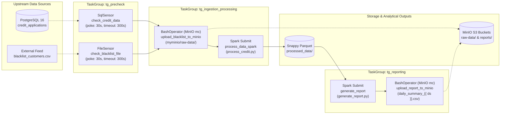

# Automated Credit Risk Decision Scoring & Workflow Orchestration Pipeline


-E25A1C?style=flat-square&logo=apachespark)


An end-to-end automated **Credit Risk Decision Scoring & ETL Pipeline** orchestrated with **Apache Airflow** (`TaskGroups`, `SqlSensor`, `FileSensor`) and **Apache Spark (PySpark)**. The pipeline validates upstream relational and flat-file data readiness, archives raw external feeds to **MinIO (S3)**, executes deterministic debt-to-income and eligibility scoring in **PySpark**, persists intermediate **Snappy Parquet** datasets, and publishes aggregated portfolio risk reports.

---

## Workflow Orchestration & Architecture (`credit_risk_etl` DAG)



---

## Deterministic Credit Risk Scoring Logic (`process_credit.py`)

The PySpark processing job extracts `credit_applications` from PostgreSQL via JDBC (`org.postgresql.Driver`), performs a left join against `blacklist_customers.csv` on `customer_id`, and classifies each application into one of three risk tiers using hierarchical rule evaluation:

| Risk Tier (`risk_status`) | Rule Evaluation Criteria | Downstream Action |
| :--- | :--- | :--- |
| **`rejected`** | Applicant `customer_id` matches an entry in `blacklist_customers.csv` (`in_blacklist == True`) | Immediate policy rejection |
| **`high_risk`** | Any of the following financial or demographic thresholds is triggered:<br/>• `requested_amount > monthly_income * 12` (Annual income cap exceeded)<br/>• `existing_debt > monthly_income * 0.7` (Debt-to-Income ratio > 70%)<br/>• `employment_years < 1` (Insufficient employment tenure)<br/>• `age < 21` (Minimum underwriting age threshold) | Escalated to manual underwriting review |
| **`approved`** | Passes blacklist screening and satisfies all DTI, income-multiple, tenure, and age thresholds | Automated credit approval |

### Portfolio Aggregation (`generate_report.py`)
Reads the scored **Snappy Parquet** output (`/opt/airflow/files/processed_data/`) and computes portfolio-level exposure metrics grouped by `risk_status`:
- `total_applications` (`COUNT(*)`)
- `total_requested_amount` (`SUM(requested_amount)`)

The resulting single-partition CSV summary is automatically uploaded to MinIO (`myminio/reports/daily_summary_{{ ds }}.csv`).

---

## Repository Structure

```text
├── airflow/
│   ├── dags/
│   │   └── credit_risk_dag.py         # Airflow DAG with 3 TaskGroups, SqlSensor, FileSensor, and Spark/MinIO tasks
│   └── files/
│       ├── blacklist_customers.csv    # External customer blacklist feed
│       ├── process_credit.py          # PySpark JDBC extraction, left-join enrichment & risk classification
│       ├── generate_report.py         # PySpark portfolio aggregation (Parquet -> CSV)
│       ├── processed_data/            # Partitioned Snappy Parquet output directory
│       └── summary_report/            # Coalesced CSV executive summary output
├── postgres/
│   └── pg_files/
│       └── credit_applications.sql    # DDL & seed records for PostgreSQL credit_applications table
├── Dockerfile                         # Custom Apache Airflow 2.10.5 image with Spark 3.5, OpenJDK 17 & MinIO mc
├── docker-compose.yaml                # Multi-container orchestration (Postgres, Airflow Init/Webserver/Scheduler, MinIO)
├── requirements.txt                   # Airflow Spark & SQL provider dependencies
└── .env.example                       # Environment configuration template
```

---

## Quick Start

### 1. Configure Environment & Build Custom Airflow + Spark Image

```bash
cp .env.example .env
docker build -t new-airflow:2.10.5 .
```

### 2. Start the Container Stack

```bash
docker compose up -d
```

### 3. Seed PostgreSQL Source Table

```bash
docker exec -i postgres psql -U airflow -d airflow < postgres/pg_files/credit_applications.sql
```

### 4. Trigger the Pipeline

Open **Apache Airflow UI** (`http://localhost:8080`, credentials: `airflow` / `airflow`) and trigger the **`credit_risk_etl`** DAG.

| Service | Endpoint | Default Credentials |
| :--- | :--- | :--- |
| **Apache Airflow UI** | `http://localhost:8080` | `airflow` / `airflow` |
| **MinIO S3 Console** | `http://localhost:9001` | `matrix` / `matrix123` |
| **PostgreSQL** | `localhost:5436` | `airflow` / `airflow` |
